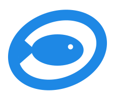

<p align="center">
  
</p>

# Tuna-Tray

A tray internet radio for Linux. Pick a station from a right-click menu, and toggle playback from a keyboard shortcut.

Tuna-Tray sits in the system tray and plays streams through [mpv](https://mpv.io). It is built for KDE Plasma, but it works with any desktop that supports the StatusNotifierItem tray protocol.

## Features

- Stations grouped by category in a tray submenu
- Left-click to start or stop playback
- A `--toggle` command for a keyboard shortcut
- Resumes the last-played station on start
- Light and dark tray icon, following the desktop colour scheme
- "Edit Stations" opens the station file in your default text editor

## Requirements

- Linux with a StatusNotifierItem tray, such as KDE Plasma
- [mpv](https://mpv.io), installed and on your `PATH`
- A notification service for toggle messages (KDE provides one)
- `xdg-open`, for "Edit Stations" (optional)

To build from source you also need a Rust toolchain, version 1.85 or newer.

## Installation

Download `tuna-tray-x86_64-linux` from the [Releases](https://github.com/joe-durbin/tuna-tray/releases) page, rename it to `tuna-tray`, and put it somewhere on your `PATH`:

```sh
install -Dm755 tuna-tray-x86_64-linux ~/.local/bin/tuna-tray
```

## Building from source

```sh
git clone https://github.com/joe-durbin/tuna-tray.git
cd tuna-tray
cargo build --release
install -Dm755 target/release/tuna-tray ~/.local/bin/tuna-tray
```

## Usage

Start the tray app:

```sh
tuna-tray
```

- **Left-click** the icon to start or stop playback.
- **Right-click** the icon to pick a station, open the station file, or quit.

### Keyboard shortcut

Tuna-Tray doesn't register a shortcut itself. To set one on KDE:

1. Open **System Settings → Keyboard → Shortcuts**.
2. Choose **Add New → Global Shortcut → Command or Script**.
3. Set the command to `tuna-tray --toggle` (or the full path to the binary).
4. Assign a key combination.

`tuna-tray --toggle` stops playback if something is playing. Otherwise it resumes the last station. If the app isn't running, it starts it.

If you haven't chosen a station yet, the shortcut shows a notification asking you to pick one from the menu.

## Stations

Stations are stored in `~/.config/tuna-tray/stations.yaml`. The file is created with a default list on first run and is never overwritten after that. Each top-level key is a category, shown as a submenu:

```yaml
Rock:
  - name: Radio X
    url: http://media-the.musicradio.com/RadioXUK

Classical:
  - name: Classic FM
    url: http://ice-sov.musicradio.com/ClassicFMMP3
```

Changes take effect the next time Tuna-Tray starts.

The last-played station is stored in `~/.local/state/tuna-tray/last.toml`.

## License

Tuna-Tray is released under the [MIT License](LICENSE). You can use, copy, modify, merge, publish, distribute, sublicense and sell it, provided the copyright notice and licence text are included in copies or substantial portions of the software.
